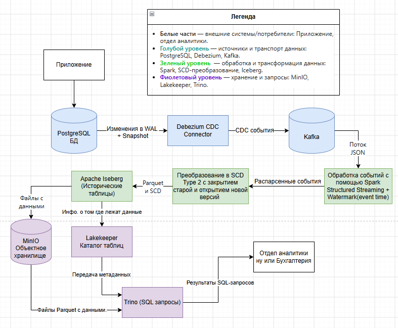

# Отчёт по практической работе №2: История в справочнике (CDC → SCD → Lakehouse)

---

## 1. Вариант и задача

| Поле | Значение |
|---|---|
| ФИО (как в VK Education) | Бахров Антон Иванович |
| Тема | Вариант 1: CDC → SCD → Lakehouse |
| Состав решения | PostgreSQL, Debezium, Apache Kafka, Spark Structured Streaming, MinIO, Lakekeeper, Apache Iceberg, Trino |
| Данные, объём | Операционные данные о банковских счетах (поля: id, owner, status, updated_at). В лабораторной работе использовался тестовый набор из 3 записей. Работоспособность пайплайна проверялась на одной записи. Предполагаемый промышленный объём — около 1 млн строк в сутки при постоянном поступлении изменений (UPDATE).|

## 2. Источники и способы сбора

| Источник | Тип | Способ сбора |
|---|---|---|
| PostgreSQL | CDC | Хранит исходные данные о банковских счетах. Debezium считывает первоначальный снимок данных и отслеживает последующие изменения записей. |
| Debezium (Kafka Connect) | CDC | Отслеживает первоначальную загрузку и изменения в PostgreSQL, преобразует их в CDC-события в формате JSON. |
| Apache Kafka| Поток | Принимает и хранит CDC-события от Debezium. Spark Structured Streaming читает сообщения из Kafka для дальнейшей обработки. |
| Apache Spark Structured Streaming | Потоковая обработка | Читает события из Kafka, разбирает JSON и подготавливает изменения для формирования истории версий записей по принципу SCD Type 2. |
| Apache Iceberg | Табличный формат хранения | Используется для хранения исторических версий данных в таблице `lakekeeper.demo.accounts_history`. |
| MinIO | Объектное хранилище | Хранит файлы данных Iceberg. |
| Lakekeeper | Каталог | Управляет каталогом Iceberg и предоставляет доступ к таблицам через REST Catalog. |
| Trino | SQL-запросы | Используется для обращения к таблицам Iceberg и проверки результатов с помощью SQL-запросов. |

## 3. Архитектура

Вставлена схема архитектуры CDC-пайплайна с материализацией SCD Type 2 в Lakehouse.



Исходный файл схемы `architecture.drawio` см. либо в папке либи в репозитории.

## 4. Docker — что поднялось

| Блок | Статус |
|---|---|
| PostgreSQL | Реализовано |
| Debezium (Kafka Connect) | Реализовано |
| Apache Kafka | Реализовано |
| Apache Spark Structured Streaming | Реализовано |
| MinIO | Реализовано |
| Lakekeeper (Iceberg REST Catalog) | Реализовано |
| Apache Iceberg | Реализовано |
| Trino | Реализовано |

### Описание действий

1. Запустил контейнеры проекта с помощью Docker Compose.
2. Проверил работу Kafka и зарегистрировал Debezium Connector для отслеживания изменений PostgreSQL.
3. Убедилися, что Kafka получает CDC-события из таблицы public.accounts.
4. Запустил Spark Structured Streaming с необходимыми библиотеками Iceberg и Kafka.
5. Spark прочитал события из Kafka и выполнил обработку данных по принципу SCD Type 2.
6. Проверил доступность таблицы accounts_history через Trino

Основные команды, использованные при работе:

```bash
# Запуск контейнеров проекта
docker compose up -d

# Проверка состояния контейнеров
docker compose ps

# Проверка схем в каталоге Lakekeeper через Trino
docker compose exec trino trino --execute "SHOW SCHEMAS FROM lakekeeper"

# Проверка таблиц в схеме demo
docker compose exec trino trino --execute "SHOW TABLES FROM lakekeeper.demo"

# Проверка структуры таблицы
docker compose exec trino trino --execute "DESCRIBE lakekeeper.demo.accounts_history"

# Для запуска Spark-приложения внутри контейнера `spark-master` использовалась команда:

docker exec spark-master /opt/spark/bin/spark-submit --master 'local[*]' --jars /opt/spark-app/jars/iceberg-spark-runtime-3.5_2.12-1.7.1.jar,/opt/spark-app/jars/iceberg-aws-bundle-1.7.1.jar,/opt/spark-app/jars/spark-sql-kafka-0-10_2.12-3.5.3.jar,/opt/spark-app/jars/spark-token-provider-kafka-0-10_2.12-3.5.3.jar,/opt/spark-app/jars/kafka-clients-3.4.1.jar,/opt/spark-app/jars/commons-pool2-2.11.1.jar /opt/spark-app/spark_scd.py
```


## 5. Описание

| Шаг | Для чего | Результат |
|---|---|---|
| 1. PostgreSQL | Хранение исходных данных о банковских счетах в таблице `public.accounts`. | Исходные записи с полями `id`, `owner`, `status`, `updated_at`. |
| 2. Debezium | Отслеживание первоначальной загрузки и последующих изменений данных в PostgreSQL. | Изменения преобразуются в CDC-события в формате JSON. |
| 3. Apache Kafka | Приём и передача событий от Debezium к Spark. | CDC-события сохраняются в топике `dbserver1.public.accounts`. |
| 4. Spark Structured Streaming | Чтение сообщений из Kafka, разбор JSON и обработка изменений. | Подготавливаются данные для формирования истории версий записей. |
| 5. SCD Type 2 | Сохранение истории изменений. При изменении полей `owner` или `status` предыдущая версия закрывается, а новая добавляется в таблицу. | Формируется история версий записей с датами действия и признаком текущей версии. |
| 6. Apache Iceberg и MinIO | Хранение исторических данных в формате Iceberg и файлов объектов в MinIO. | Данные сохраняются в таблице `lakekeeper.demo.accounts_history`. |
| 7. Lakekeeper и Trino | Управление каталогом Iceberg и выполнение SQL-запросов к таблице. | Можно обращаться к историческим данным и проверять результат с помощью SQL-запросов. |

## 6. Выводы

В ходе выполнения практической работы была разработана система обработки изменений данных о банковских счетах на основе CDC и SCD Type 2. Были объединены PostgreSQL, Debezium, Apache Kafka и Spark Structured Streaming для передачи и обработки изменений в потоковом режиме. Для хранения исторических версий данных использовались Apache Iceberg и MinIO, Lakekeeper обеспечивал управление каталогом, а Trino — выполнение SQL-запросов к данным. В результате удалось настроить взаимодействие компонентов, организовать обработку CDC-событий и реализовать механизм сохранения исторических версий записей. В ходе работы были получены практические навыки настройки Docker-контейнеров, работы с потоковой обработкой данных и построения Lakehouse-архитектуры.
